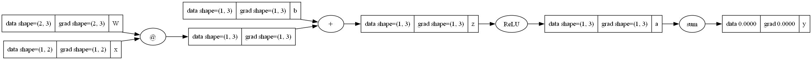

# Custom ML Library and Autograd Engine

A Python–NumPy machine learning library developed by Raju Santhani as part of a Foundations of Machine Learning course project at IIT Hyderabad.

The project implements core learning algorithms and neural-network components without using PyTorch or scikit-learn for model training. It includes assignment scaffolding and completed implementations; it is an educational library, not a production framework.

## Features

- Binary logistic regression with L2 regularization and IRLS optimization.
- One-vs-rest classification through the experiment scripts.
- NumPy-based automatic differentiation and computation graphs.
- Linear layers, ReLU, Sigmoid, and Sequential containers.
- Cross-entropy and binary cross-entropy losses, plus SGD.
- Standardization, polynomial features, and Gaussian basis features.
- Train/validation/test splitting and K-fold cross-validation.
- Fashion-MNIST and Spambase CSV/data loaders.
- Computation-graph visualization using Graphviz.

## Computation graph



## Files

```text
my_ml_lib/              Library source code
capstone_showdown.py    Command-line classification experiments
run_experiments.py     Hyperparameter-search experiments
visualize.py           Graph visualization helpers
mlp_visual_test.py      Small computation-graph example
create_best_model.py   Model reconstruction helper
computational_graph.png
saved_models/          Archived logistic-regression checkpoint
docs/submission_readme.md  Original submission notes
```

## Setup

From this directory, install the Python dependencies:

```bash
python -m pip install -r requirements.txt
```

Rendering a new graph also requires the Graphviz application and its `dot` executable on PATH. The existing graph image can be viewed without installing it.

Create a `data/` directory and supply the local data files expected by the loaders:

- `fashion-mnist_train.csv`: a CSV with a `label` column and 784 pixel columns.
- `fashion-mnist_test.csv`: the same format, for use with the loader's test option.
- `spambase.data`: headerless Spambase data, with the class label in the last column.

Datasets are not included. The classification scripts split the training CSV into 70% training, 15% validation, and 15% test data.

## Experiment commands

The actual entry point in this archive is `capstone_showdown.py`, not the `train_model.py` named in the original submission README.

```bash
python capstone_showdown.py --help
python capstone_showdown.py --model mlp --hidden 256 --lr 0.1 --epochs 12 --mark-best
python capstone_showdown.py --model softmax_rbf --n-centers 60 --sigma 0.5 --lr 0.1
python capstone_showdown.py --model logistic --alpha 0.1 --epochs 200
```

These document the supplied interfaces. Full training and benchmark reproduction have not been validated for this upload.

## Results and current limitations

The original submission notes report approximately 61% validation accuracy for the MLP. Their test accuracies are approximate, and the ZIP contains no experiment summary or MLP `.npz` checkpoint to verify them. Treat these as historical notes, not verified benchmark claims.

The archive contains the library and experiment code, with these known issues:

- The raw-softmax branch calls `load_state_dict` where it appears intended to save its trained model; it may fail if the checkpoint does not already exist.
- The training loop records a best-validation state, but the MLP branch saves the final model without restoring that state.
- The logistic-regression test evaluation in `run_experiments.py` does not apply the training scaler to test features.
- Polynomial softmax has a branch in the trainer but is not exposed in its command-line choices. The historical notes say polynomial experiments were skipped.
- Only `saved_models/best_model.pkl` is included. MLP and softmax checkpoints mentioned in the original notes are absent.

## Attribution

Developed for the Foundations of Machine Learning course assignment, using the supplied assignment structure and scaffolding. The assignment recommends Andrej Karpathy's micrograd tutorial as a learning resource. Credit any additional code sources used before publishing under a new license.

## Author

Raju Santhani — M.Tech Smart Mobility, IIT Hyderabad.
